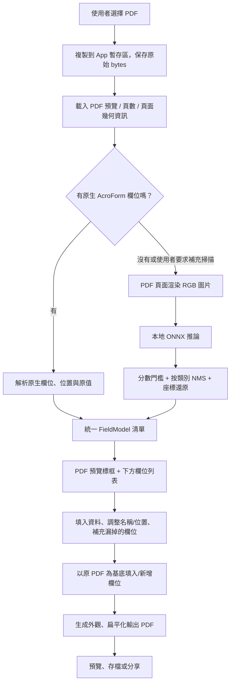

# Flutter 離線 PDF 表單欄位辨識與填寫 Demo — 實作規格

> 給 Codex 的開發任務：**請直接在目前專案中實作可執行的 Flutter Demo，不要只輸出設計稿、虛構的辨識結果或待辦清單。**若專案尚未建立，建立 Flutter App。完成後執行格式檢查、靜態分析與可執行的測試，整理實際完成情況。

## 一、目標與驗收情境

建立一個 **iOS + Android** 的 Flutter App，將使用者選取的 PDF **完全在裝置本地**分析，找出可以填寫的欄位，讓使用者在畫面下方輸入資料，再將資料填回**原始 PDF**，匯出新的 PDF。

典型操作：

1. 點選「開啟 PDF」，從系統檔案選擇器選取本地 PDF。
2. 顯示原始 PDF 預覽、頁數與「辨識欄位」按鈕。
3. 點選辨識，逐頁分析；預覽上顯示欄位半透明框與編號。
4. 下方顯示已辨識欄位清單，可修改欄位名稱、輸入文字、勾選選項或提供手寫簽名。
5. 點選某個欄位時，PDF 預覽跳到對應頁面並高亮其位置；允許手動新增、刪除或校正誤判欄位。
6. 點「預覽結果」看填入後的 PDF，再點「匯出 PDF」存到檔案或使用系統分享功能。
7. 使用系統 PDF 閱讀器開啟匯出檔，原有內容、版面與頁數都保留，填寫內容出現在正確欄位上。

**全程離線約束**：PDF 內容、影像、表單資料、推論請求都不能送到伺服器；不使用雲端 OCR、LLM API、遠端模型端點。套件與模型可以在**開發階段**下載；**App 安裝完成後，即使飛航模式也必須能用全部核心功能**。

### 本次範圍

- PDF 類型：
  - 原生可填寫 PDF（AcroForm）：先讀取現成欄位，不浪費模型推論。
  - 一般文字型 PDF、沒有 AcroForm 的空白表格：使用 ONNX 模型找空白欄位。
  - 掃描 PDF：每頁渲染成圖片，同樣使用模型偵測。
- 偵測類型：`text`、`checkbox`（模型原始類別 `ChoiceButton`；未分類出單選群組）、`signature`。
- 中英文字填入與正確匯出，尤其要測試**繁體中文**。
- 支援多頁 PDF，欄位依頁面分組、排序。
- 欄位錯誤時要能人工校正；不得把模型辨識準確率當成 100%。

### 暫不追求

- 自動理解「姓名」「電話」「身分證字號」語意；模型只偵測位置、類型，不輸出欄位名稱。預設標籤採「第 1 頁・文字欄位 1」等，讓使用者自行更名。
- 複雜表格語意、手寫文字 OCR、AI 自動代填、電子憑證數位簽章、XFA 表單、遠端同步。
- 重新排版 PDF，或將整頁 PDF 轉成圖片後取代原稿。**應保留原 PDF**，只新增/填入必要內容。

## 二、技術選型

| 用途 | 技術 | 要求 |
| --- | --- | --- |
| UI | Flutter + Material 3 | 單一 Codebase，介面極簡、繁體中文 |
| 選檔 | `file_picker` | iOS Files / Android SAF，讀取 PDF Bytes/本地路徑 |
| PDF 預覽、頁面渲染 | `pdfrx`（PDFium） | PDF 預覽與頁面轉圖片；利用 `pageOverlaysBuilder` 或等價 API 畫偵測框 |
| 欄位偵測 | `nutrientdocs/form-field-v1-nano` | 本機 ONNX；FP32 `model.onnx`，約 3.7 MB；Apache-2.0 |
| ONNX Runtime | `flutter_onnxruntime` | iOS / Android 本地 CPU 推論；請根據安裝版本的真實 API 建立 session、tensor 與釋放資源 |
| PDF AcroForm／輸出 | `syncfusion_flutter_pdf` | 讀取現有表單、加新表單欄位、填值、flatten、儲存現有 PDF |
| 圖片處理 | Dart `image` 或其他本地套件 | PNG/RGB 轉 tensor；不可依賴 Python Runtime |
| 檔案路徑與分享 | `path_provider`、`share_plus`（視需要） | 匯出新檔至暫存，再用系統分享／儲存入口 |
| 狀態 | `ChangeNotifier` / `ValueNotifier` 或 Riverpod | 狀態只需簡單、可測試；避免過度架構 |

**平台最低要求**：iOS 16.0+（`flutter_onnxruntime` 限制）；Android `minSdk` 依選定套件的當前要求設定，優先支援 Android 8.0+，不可假設版本而不檢查。`pdfrx` 新版可能要求 Flutter 3.47 / Dart 3.13；如果專案環境較舊，請先核對相容版本，合理升級或選相容版本，並把版本寫在 README。

**授權注意**：Syncfusion PDF 不是 MIT 開源套件，使用須符合其 Community License 或商業授權條件；Demo 可以採用，但 README 必須清楚標記。將 PDF 編輯實作封裝在 `PdfExportService`，未來方便替換。中文 PDF 請以合法授權的繁中字型（例如專案自行取得的 Noto Sans TC）嵌入，附字型授權說明；**不要使用 PDF Standard Helvetica 直接繪製中文**。

官方資料：

- 模型、ONNX 格式及授權：https://huggingface.co/nutrientdocs/form-field-v1-nano
- FP32 權重：https://huggingface.co/nutrientdocs/form-field-v1-nano/resolve/main/model.onnx
- ONNX Runtime Flutter：https://pub.dev/packages/flutter_onnxruntime
- pdfrx：https://pub.dev/packages/pdfrx
- pdfrx 頁面覆蓋元件：https://pub.dev/documentation/pdfrx/latest/pdfrx/PdfViewerParams-class.html
- Syncfusion 表單：https://help.syncfusion.com/document-processing/pdf/pdf-library/flutter/working-with-forms
- Syncfusion 授權：https://pub.dev/packages/syncfusion_flutter_pdf/license

## 三、資料流程



**原則**：

- 以**每頁**為推論單位，建立 session 一次、重複使用，不要每頁重載權重。
- PDF 渲染解析度與 PDF 實際尺寸分離，統一以**頁面相對座標**儲存欄位。
- 原生欄位優先，AI 欄位可以補充；合併前以同頁 bounding box 的 IoU 去重，避免雙重欄位。
- 推論完成應釋放頁面圖片、tensor、native memory，不保留所有頁面的 640×640 Float32 tensor。
- 不可把預覽疊加的綠色框真正印進最後 PDF。

## 四、模型整合（最重要，不能使用假資料）

### 4.1 模型準備

將官方 `model.onnx` 放在 `assets/models/form_field_v1_nano.onnx`，在 `pubspec.yaml` 宣告 asset。請於專案 README 記錄下載來源、原始檔名、SHA-256 實際校驗值與 License。下載只在開發階段發生；不要在 App 執行時下載。

優先使用 FP32 CPU 模型，確保 iOS / Android 行為一致；FP16 可留待效能優化，不列入第一版。

### 4.2 前處理（按照模型官方 Card）

1. 將一頁 PDF 渲染為**方向正確、包含可見頁面區域**的 RGB 圖片，取得 `sourceWidth`、`sourceHeight`。
2. `S = 640`，比例 `r = min(640/sourceWidth, 640/sourceHeight)`。
3. 縮小至 `round(sourceWidth * r)` × `round(sourceHeight * r)`，請固定明確的 rounding 實作並在映射時採用實際尺寸。
4. 創建 640×640 RGB 畫布，背景色 `(114,114,114)`；**貼在左上角 `(0,0)`**，不是置中 padding。
5. Float32 input tensor shape `[1,3,640,640]`，排列 `NCHW`，channel 依序 `R,G,B`。
6. **像素值是 0–255 的 Float32；不要除以 255、不要 ImageNet normalize，也不要 BGR。**
7. session 的 input name 由模型/實際推論介面確認；不要寫死猜測的名字。

### 4.3 後處理（不能省略）

官方 FP32 ONNX 輸出預期為 `[1,8400,8]`，每一列依序：

```text
[cx, cy, width, height, objectness, P(Text), P(ChoiceButton), P(Signature)]
```

模型**已內建解碼**，不得再次套 YOLO grid decode。實作步驟：

1. 對每列各類別計算 `score = objectness × classProbability`，取最高類別。
2. 初始 `confidenceThreshold = 0.30`，可在 UI 中提供進階調整；過低信心的框不顯示。
3. 中心點轉角點：`x1 = cx - width/2`、`y1 = cy - height/2` 等。
4. 同類別執行 Non-Maximum Suppression，初始 `iouThreshold = 0.60`。
5. 因為 padding 在**右方與下方**，將框座標除以 `r` 還原至原始頁面像素；裁切至有效頁面邊界。
6. 濾掉負尺寸、極小或不合理的框（規則要寫測試），再轉換成標準化 `Rect`，範圍均為 0～1。
7. 類別 `0 = text`、`1 = checkbox`、`2 = signature`，目前不要把每個 ChoiceButton 自動當成 radio group。
8. 依頁碼、Y、X 排序，產生穩定 ID。辨識結果不可用硬編碼框取代。

> 提醒：以上輸入輸出來自 `form-field-v1-nano` 官方模型卡。`90 pages/sec` 是作者的筆電 CPU 測試，**不是手機速度保證**；App 顯示逐頁進度並保持畫面可操作。

### 4.4 ONNX 執行與記憶體

- 封裝 `FormFieldDetector`，暴露 `initialize()`、`detectPage()`、`dispose()`。
- Session 只建立一次，使用 CPU Execution Provider。Android / iOS 都需能載入 asset。
- 避免在 UI thread 上做影像解碼、前處理與 NMS；使用 isolate 或適合該套件的非同步方式。不要在 isolate 中跨越不支援的 native resource。
- 每次推論後正確釋放 input/output `OrtValue` 與 session。監控長篇 PDF 的記憶體，不得先載入全部頁為高解析度圖片。
- 發生 ONNX 不支援、輸入 shape 不符時顯示可理解的錯誤；**不可改用模擬辨識結果矇混成功**。

## 五、欄位資料模型

請建立統一資料結構，供 PDF 原生欄位及 AI 欄位共用：

```dart
// 示意資料模型；可用 sealed classes / enum 改善型別安全。
enum FormFieldType { text, checkbox, signature }
enum FormFieldSource { acroForm, detected, manual }

class NormalizedBox {
  final double left;   // 0..1, 可見頁面左上角為 (0,0)
  final double top;    // 0..1
  final double width;  // 0..1
  final double height; // 0..1
}

class DetectedFormField {
  final String id;
  final int pageIndex;              // 0-based
  final FormFieldType type;
  final FormFieldSource source;
  final String label;              // 使用者可編輯
  final NormalizedBox box;
  final double? confidence;         // AI 欄位才有
  final String? originalAcroName;   // 原生欄位原名
  final String? originalAcroRef;    // 必要時記錄唯一識別資訊
  final String textValue;
  final bool checked;
  final Uint8List? signaturePng;   // 手寫簽名的本地 PNG bytes
}
```

- 另外建立 `PdfPageGeometry`，至少包含原始頁尺寸、可見區 CropBox、MediaBox、旋轉角度、渲染圖片尺寸與頁面索引。
- 將相對位置的座標轉換封裝成 `PageCoordinateMapper`，提供 `imageToNormalized`、`normalizedToViewer`、`normalizedToPdf`。
- **不能假設所有 PDF 都是 A4、72 DPI、0°、沒有 CropBox。** PDF 頁面與畫面 zoom/scroll 也不可混用。
- 對 0°、90°、180°、270° 旋轉、不同頁面尺寸與 CropBox 分別測試；如果目前 PDF 編輯套件在旋轉頁面有已知限制，須在 UI 明確提示並拒絕錯誤匯出，而不是輸出到錯位座標。
- 在 `pdfrx` 的 `pageOverlaysBuilder` 或 `pagePaintCallbacks` 中，使用**當前頁面實際顯示矩形**轉換。縮放、捲動、旋轉後框仍需對齊。

## 六、PDF 處理與匯出

### 6.1 已有 AcroForm

1. 以 `syncfusion_flutter_pdf` 讀取原始 PDF `PdfDocument(inputBytes: originalBytes)`。
2. 枚舉 `document.form.fields`，讀取欄位的類型、名字、目前值、頁碼與位置（依實際 API）。
3. 已有 `PdfTextBoxField`、`PdfCheckBoxField`、`PdfRadioButtonListField` 等欄位時，優先直接使用；radio group 若解析不完整可在 UI 標為「尚不支援」並保持原值，不可靜默刪除。
4. 輸出時將使用者修改值寫回**原欄位**，避免在其上再畫一層欄位。
5. 若使用者按「補充 AI 掃描」，偵測新增欄位，並與原生欄位按照位置及類型去重。

### 6.2 AI 找到但原 PDF 沒有欄位

- 以原始 PDF bytes 重新載入文件；**不要重新建立空白 PDF**。
- 對 `text` 建立 `PdfTextBoxField`（或等價的可填寫欄位），輸入文字與正常外觀；對 `checkbox` 建立 `PdfCheckBoxField`。
- `signature` 使用本地手寫簽名板收集筆跡，將 PNG 以透明背景放進正確頁面位置；這是**簽名圖片**，不是憑證數位簽章，不要宣稱具有驗證效力。若未簽名，保持原 PDF 空白。
- 模型偵測框可能比文字實際可用空間大，請讓使用者編輯位置及框大小；禁止在 PDF 畫出偵測彩框。
- 中文輸出必須載入具繁中文字形的 `PdfTrueTypeFont` 或等價字型，字型在 App assets 中取得，不使用需線上下載的字型。
- 根據欄位框高與文字內容選擇字級，必要時縮放或自動換行。不得讓中文顯示方框、亂碼、截斷到相鄰欄位。
- 呼叫 `document.form.setDefaultAppearance(true)` 或依實際版本設定欄位外觀，確保 Apple Preview、Android PDF Viewer 等看得到填入的值。

### 6.3 匯出格式

**預設匯出：扁平化（flattened）PDF**。流程為：

1. 從原始 PDF 建立可修改的 `PdfDocument`。
2. 更新原生欄位，新增 AI / 手動欄位並填入值；保留原始頁面、圖像、既有文字、其他表單欄位。
3. 確認所有欄位可見外觀；`document.form.flattenAllFields()`（或適用的單欄位扁平化 API）。
4. 將簽名圖片嵌入（注意 PDF 圖層順序與透明背景）；必要時在 flatten 前後按實際疊層情況處理。
5. `await document.save()`，取得新 PDF bytes；釋放 `document`。
6. 新檔命名 `<原檔名>_filled.pdf`，儲存到 App 暫存，提供分享/另存；原檔保持不變。
7. 匯出後再次開啟新 PDF 做檢查與預覽。

第二階段可加「保持可編輯表單」選項；**Demo 第一優先是可靠的扁平化輸出**。

若 Syncfusion 於特定版本的既有 PDF 表單更新／中文字型顯示存在問題，先建置能通過端到端測試的匯出路徑，記錄具體限制；**不要轉成整頁 PNG 當作完成**。

## 七、畫面設計

使用繁體中文、Material 3、低彩度極簡 UI；不需要華麗動畫。

### 首頁／單頁工作區

```text
┌──────────────────────────────────────────┐
│ PDF Form Demo                 [選擇 PDF] │
├──────────────────────────────────────────┤
│ application.pdf      3 頁    [辨識欄位] │
│                                          │
│ ┌──────────────────────────────────────┐ │
│ │              PDF 預覽                │ │
│ │   姓名： [  ① 偵測欄位     ]        │ │
│ │   地址： [  ② 偵測欄位     ]        │ │
│ │   □ ③ 同意                          │ │
│ │                                      │ │
│ └──────────────────────────────────────┘ │
│ 第 1 / 3 頁        已辨識 8 欄          │
├──────────────────────────────────────────┤
│ 欄位清單                    [+ 新增欄位] │
│ ① [姓名 / 欄位名稱可修改]               │
│    [請輸入內容________________]         │
│ ② [地址]                               │
│    [請輸入內容________________]         │
│ ③ [同意]                       [□]     │
│                                          │
│         [預覽結果]   [匯出 PDF]          │
└──────────────────────────────────────────┘
```

- 手機垂直畫面：上方 PDF 預覽約 50–60%，下方可捲動欄位清單或可拉伸 Bottom Sheet；橫向自適應。
- AI 框顯示淡色描邊與序號，選取中的欄位顯示明確高亮。
- 清單依頁分組，欄位有名稱、類型、頁碼、低信心標示、編輯與刪除入口。
- 對 AI 欄位提供「調整位置」模式，可在預覽中拖動和縮放框；也允許點 PDF 空白位置新增 `text` / `checkbox` / `signature` 欄位。
- 切換頁面、縮放 PDF 時不遺失任何已輸入的值；鍵盤彈出不遮住正在編輯的輸入框。
- 無欄位、解析失敗、部分頁面辨識失敗、大型檔案或加密 PDF 都要有明確狀態訊息。
- 初始模型偵測不成功也能手動新增欄位並完成匯出，讓 Demo 流程不中斷。

## 八、建議專案檔案配置

```text
lib/
  main.dart
  app.dart
  features/pdf_form/
    models/
      detected_form_field.dart
      normalized_box.dart
      pdf_page_geometry.dart
    services/
      pdf_import_service.dart
      pdf_render_service.dart
      acroform_reader.dart
      form_field_detector.dart
      onnx_preprocessor.dart
      onnx_postprocessor.dart
      page_coordinate_mapper.dart
      pdf_export_service.dart
    controllers/
      pdf_form_controller.dart
    widgets/
      pdf_field_overlay.dart
      field_editor_list.dart
      field_editor_tile.dart
      signature_pad.dart
    screens/
      pdf_form_screen.dart
assets/
  models/
    form_field_v1_nano.onnx
  fonts/
    ... # 用專案確認授權、真正具繁中字形的字型
  sample/
    ... # 測試用 PDF（自行生成，不含個資）
test/
  onnx_preprocessor_test.dart
  onnx_postprocessor_test.dart
  page_coordinate_mapper_test.dart
  pdf_export_service_test.dart
integration_test/
  pdf_form_flow_test.dart
README.md
```

如已有 Flutter 專案，沿用原有檔案與狀態管理規範；上述只是建議。服務介面應可獨立測試，不要把推論或 PDF 編輯程式全部寫在 Widget 的 `build()` 中。

## 九、必須通過的測試

### 單元測試

- 前處理：不同長寬比例的圖片都產生 `[1,3,640,640]`，確認左上角放置、背景 114、channel 順序與非 0–1 正規化。
- 後處理：手寫合成 tensor，驗證分數、類別、NMS、邊界裁切、`r` 反算；確認沒有重複 decode。
- 座標：頁面不同大小、縮放、90/180/270° 旋轉、CropBox，image → normalized → PDF round-trip 在容許誤差內。
- 相同頁面 AI 與 AcroForm 的重疊去重；不同頁面不可互相去重。
- 欄位排序、增刪、改名、勾選與狀態保存。

### PDF 夾具（fixture）

請建立/附上**不含個資**的測試 PDF：

1. `simple_blank.pdf`：一頁有姓名、地址的空白線/方格、核取方塊、簽名區，**沒有 AcroForm**。
2. `existing_acroform.pdf`：一頁真正的文字方塊與勾選框，預設值可讀。
3. `multi_page.pdf`：至少 2 頁，各自不同欄位與位置。
4. `scanned_blank.pdf`：只有掃描圖片的 PDF，沒有文字層。
5. `rotated_page.pdf`：含旋轉頁，用於座標校正。

### 端到端驗收

- Android 真機、iPhone 真機或 iOS 模擬器上，能載入 asset ONNX、推論一頁真實 PDF、取得非硬編碼的結果。Android 模擬器也盡可能驗證。
- 以上四種類型的主要 PDF 在飛航模式下可選取、預覽、偵測、輸入及輸出。
- 「王小明」「臺北市」「A123456789」等字元能在匯出後看到，字體不亂碼、不位移；勾選狀態能保留。
- 多頁 PDF 匯出後頁數不變，未填區域與原有文件內容不變。
- 選取 PDF 中的某個高亮框，下方選中正確欄位；從清單選欄位，預覽跳至正確頁。
- 重新開啟已輸出的 PDF，視覺確認資料位置，並且可以用 PDF 解析工具確認文檔仍有效。
- 斷網不影響使用；不得出現模型首次啟動下載訊息或遠端 API 呼叫。
- 最後執行 `flutter format`（若 CLI 不支援此命令，用 `dart format`）、`flutter analyze`、`flutter test`，並回報測試結果。

### 完成定義（DoD）

- [ ] **真實 ONNX 模型**能在 iOS、Android 載入與推論，不可只用 mock。
- [ ] 原生 AcroForm 有欄位時可直接顯示並填寫。
- [ ] 一般 PDF / 掃描 PDF 可經模型得到候選欄位。
- [ ] 下方欄位清單可修改、輸入、勾選；簽名欄可本地手寫或保持空白。
- [ ] PDF 上標示位置，頁碼及座標正確，支援人工校正與新增欄位。
- [ ] 完整輸出新 PDF，原有頁面保留，中文正確顯示。
- [ ] 飛航模式可完成流程，且不傳輸個人或 PDF 資料。
- [ ] 提供 README：安裝、雙平台建置、授權、模型與字型來源、測試方式、已知限制。

## 十、Codex 的執行順序與交付說明

請按以下順序實作，不要跳過真正模型推論直接裝飾 UI：

1. 檢查目前 Flutter、Dart、Xcode、Android toolchain 與套件相容性；初始化專案。
2. 下載並放入正式 ONNX 權重、確認資產打包與 session 初始化。
3. 先做最小 inference smoke test：讀取一張 PDF 頁面 → 預處理 → ONNX → NMS → 印出至少一個 `type + score + bbox`；若測試頁剛好沒有候選框，改用有明確欄位的 fixture，不得捏造結果。
4. 串接 PDF 匯入、預覽及欄位 overlay，讓使用者能看到辨識結果。
5. 串接 AcroForm 讀取、底部清單、欄位編輯及手動修正。
6. 實作原始 PDF 的欄位填寫、扁平化匯出與結果預覽。
7. 編寫單元及整合測試，跑靜態檢查；實測 iOS、Android 能跑到的階段。
8. 最後輸出：完成的功能、實際測試指令與結果、未完成項、必要的環境設定，以及專案啟動方式。

**不要回覆「可以做到」後就結束；要在目前工作區建立原始碼、測試和 README。沒有 iOS 編譯環境時，完成可共用的 Flutter 原始碼與 Android 測試，具體註明 iOS 尚未驗證，不能宣稱兩端都已成功。**
